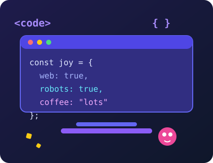

### `CSE Student  •  Web Apps  •  Robots`

---

## 👋 About Me

<table>
<tr>
<td width="62%">

Hi, I'm **Joy Pramanik** — a **BSc in CSE student at Southeast University, Dhaka, Bangladesh**, building my career in web development and robotics.

I love turning ideas into real products. I work with **HTML, CSS, JavaScript, PHP, MySQL, ESP32 and Arduino Nano** to build websites, booking systems and robots that actually work.

> **🌐 Web Development:** I build full websites — from an e-commerce platform to tour booking systems and my own portfolio.
>
> **🤖 Robotics:** I build robots with ESP32 and Arduino Nano — a rover and a line-following robot, both as team leader.
>
> **✈️ Tour Booking:** I build booking systems where people browse packages, book trips, use coupons and pay — with an Admin Panel behind it.

I'm looking for **internship and entry-level CSE / IT opportunities** where I can learn, contribute, and grow with a team.

</td>
<td width="38%" align="center">

**🌐 Live Portfolio**

**[joypramanik02.github.io/portfolio-website-/](https://joypramanik02.github.io/portfolio-website-/)**

</td>
</tr>
</table>

---

## 💡 What I Do

| 🌐 Web Development | 🤖 Robotics & Embedded | ✈️ Tour Booking Systems |
|---|---|---|
| Full websites with HTML, CSS, JavaScript, PHP and MySQL — from an e-commerce platform to a personal portfolio. | Robots built with ESP32 and Arduino Nano — a rover and a line-following robot, both as team leader. | Tour & travel booking systems — browse packages, book trips, coupons, wishlists, payments and reviews, plus an Admin Panel. |

---

## 🛠️ Tech Stack

**Languages:** C, Python, HTML, CSS, JavaScript, PHP, MySQL
**Embedded & Hardware:** ESP32, Arduino Nano
**Tools:** Git, GitHub, VS Code, Arduino IDE

---

## 🚀 Featured Projects

### 👗 [Joy Fashion](https://github.com/joypramanik02/joy-fashion) — [🔴 Live](https://joypramanik02.github.io/joy-fashion/)
Professional fashion & clothing e-commerce store for Dhaka — 12 products, search & filters, cart, delivery charges, Cash on Delivery / bKash / Nagad checkout and order history.
`HTML` `CSS` `JavaScript`

### 🚆 [Railway Ticket Tracker](https://github.com/joypramanik02/railway-ticket-tracker) — [🔴 Live](https://joypramanik02.github.io/railway-ticket-tracker/)
Search Bangladesh Railway trains, compare sample fares by class, check demo seat availability, and save trips and seat alerts.
`HTML` `CSS` `JavaScript`

### 🌐 [Portfolio Website](https://github.com/joypramanik02/portfolio-website-) — [🔴 Live](https://joypramanik02.github.io/portfolio-website-/)
My personal portfolio — About, Skills, Projects, Achievements, Education and Contact.
`HTML` `CSS` `JavaScript`

### ✈️ [CholoGhuri](https://github.com/joypramanik02/chologhuri) — Tour & Travel Booking Management System
Users explore tour packages, book trips, apply discount coupons, manage wishlists, pay (demo), and submit reviews. Admins manage packages, bookings, users, reviews, coupons and payments.
`PHP` `MySQL` `HTML` `CSS` `JavaScript`

### 🧳 [Tour and Travel Booking](https://github.com/joypramanik02/joypramanik02-s-Org)
An easy-to-use tour and travel booking system with package browsing, quick booking, price calculation, and ticket vouchers.
`TypeScript`

### 🛒 E-commerce Website — Team Leader
A web-based shopping platform built as a team project.
`HTML` `CSS` `JavaScript` `PHP` `MySQL`

### 🤖 Arduino Rover — Team Leader
A rover built using an ESP32-based control system.
`ESP32`

### 🤖 Line Following Robot — Team Leader
A line-following robot built using Arduino Nano.
`Arduino Nano`

---

## 🏆 Achievements

| 🏆 Achievement | 🎪 Event |
|---|---|
| **2nd Runner-Up — RoboSoccer** | JnU AI & IT Fest 2026 (Jagannath University IT Society) |
| **Participant — RoboFusion 1.0** | UFTB Robotics Club |
| **Participant — REACT 2026** | IEEE Southeast University Student Branch |

## 🎓 Education

- **B.Sc. in Computer Science & Engineering** — Southeast University, Dhaka (Expected Graduation: 2027)
- **HSC, 2020** — Naogaon Government College, GPA 5.00
- **SSC, 2018** — BIAM Laboratory School & College

---

## 📊 GitHub Stats

---

## 📫 Connect with me

**💬 Open to internship and entry-level CSE / IT opportunities — let's talk!**

---

### Thanks for visiting! 👋

